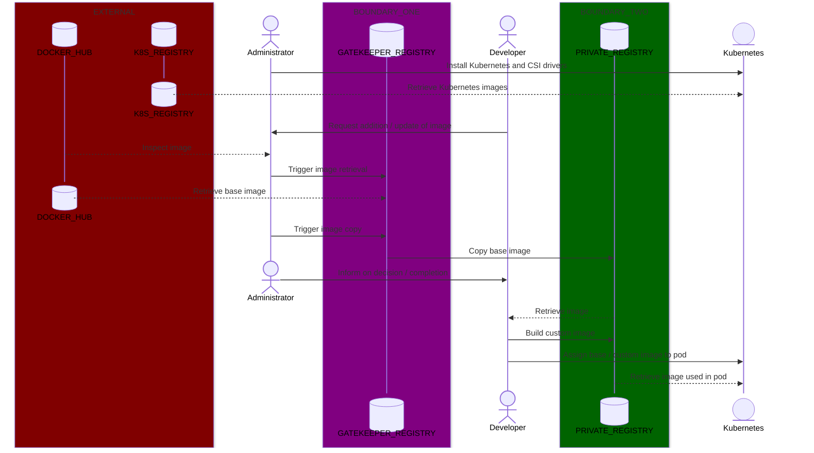

# Trust boundaries
*Note: this file was auto-generated and redacted from the original file.*

## Flow of container images
Trust boundaries are currently enforced by read-write (solid lines) and read-only (dotted lines) personal access tokens.

Retrieval of images from the Kubernetes registry via the gatekeeper registry is planned, as is verification / signing of images and policy-enforcement via **Kyverno**.

