# Trust boundaries
*Note: this file was auto-generated and redacted from the original file.*

## GitOps (Flux)
Trust boundaries are currently enforced by different Git repositories and their access tokens.

